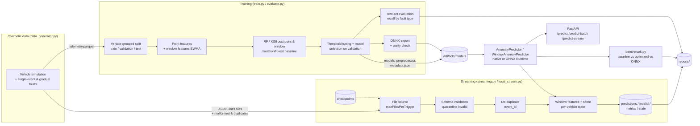

# Real-Time Vehicle Telemetry Anomaly Detection & Edge ML Optimization

[](https://github.com/Charanloyal/Real-Time-Vehicle-Telemetry-Anomaly-Detection-Edge-ML-Optimization/actions/workflows/ci.yml)
[](https://render.com/deploy?repo=https://github.com/Charanloyal/Real-Time-Vehicle-Telemetry-Anomaly-Detection-Edge-ML-Optimization)

End-to-end portfolio project. It generates vehicle telemetry with single-event and gradual faults, and trains
per-event ("point") and per-vehicle-history ("window") anomaly detectors with scikit-learn and XGBoost. It
compares them with an unsupervised IsolationForest baseline, and validates and scores event streams with
PySpark Structured Streaming (with a pandas fallback engine) while carrying per-vehicle state across
micro-batches. Predictions are served over FastAPI with an optional ONNX Runtime backend, and optimized
inference is benchmarked against a straightforward baseline.

**Live demo:** <https://vehicle-telemetry-anomaly-detection.onrender.com/> (API docs at
[/docs](https://vehicle-telemetry-anomaly-detection.onrender.com/docs)). It runs on Render's free plan, so the
first request after a period of inactivity can take up to a minute while the instance wakes up.

> **Data disclaimer:** every dataset in this repository is **synthetic**, produced by
> [`data_generator.py`](src/vehicle_anomaly/data_generator.py). No real vehicle, fleet or production telemetry
> is used, and none of the metrics below describe real-world performance.

**Status:** complete as a portfolio project (CI green: lint, strict type check, 109 tests, Docker smoke test).
Synthetic data only; the Kafka source is not implemented (the streaming input is JSON Lines files).

### What "real-time" and "edge" mean in this project

- **Real-time** means *micro-batch* stream processing plus low per-event scoring latency, not a hard real-time
  system. The streaming pipeline reads JSON Lines files in micro-batches (Spark Structured Streaming or a pandas
  engine), by default processing the backlog and stopping (`available_now`); a polling `processing_time`
  trigger is also available. The API scores single events or small batches on request. There is no message
  broker, no event-time watermarking and no latency SLO.
- **Edge ML optimization** means making single-event CPU inference cheap: a NumPy feature path instead of
  pandas, and ONNX Runtime with **one** thread as an edge-like setting, plus smaller artifacts. All latency
  numbers were measured on one x86 developer laptop (and a shared Render CPU); the models have **not** been run
  or measured on an embedded/ARM device or in a vehicle.

## Contents

- [What "real-time" and "edge" mean in this project](#what-real-time-and-edge-mean-in-this-project)
- [Architecture](#architecture)
- [Features and status](#features-and-status)
- [Technology stack](#technology-stack)
- [Repository structure](#repository-structure)
- [Installation](#installation)
- [Running the project](#running-the-project)
- [Model training and evaluation](#model-training-and-evaluation)
- [Streaming pipeline](#streaming-pipeline)
- [API and live demo](#api-and-live-demo)
- [Inference optimization and benchmark](#inference-optimization-and-benchmark)
- [Testing and CI](#testing-and-ci)
- [Docker](#docker)
- [Deploying to Render](#deploying-to-render)
- [Configuration](#configuration)
- [Limitations and future work](#limitations-and-future-work)

## Architecture



## Features and status

| Area | Status | Notes |
|---|---|---|
| Synthetic telemetry generator (seeded, configurable volume) | Implemented | 5 single-event fault types + 2 gradual drift types; cold or warm (mid-trip) starts; streaming files with 6 kinds of malformed events and duplicates |
| Per-vehicle window features (EWMA deviation/trend) | Implemented and verified | One implementation for training, streaming and API; chunked processing with state is bit-identical to a full pass (tested) |
| Point vs window models (RandomForest, XGBoost) + IsolationForest baseline | Implemented | Vehicle-grouped splits, validation-tuned thresholds and selection, recall per fault type |
| Evaluation: precision, recall, F1, ROC-AUC, PR-AUC, confusion matrix | Implemented | Plus recall per anomaly type and Matplotlib figures |
| Optimized inference path and benchmark | Implemented | Native path bit-identical to the reference path; measured numbers below |
| ONNX export + ONNX Runtime serving (edge runtime) | Implemented and verified | Exported at training time with a parity check; benchmarked for latency, throughput, size and load time; used on Render |
| Streaming: pandas micro-batch engine (default on Windows) | Implemented and verified | File checkpoint, per-vehicle window state per batch, idempotent sinks; crash-replay reproduces scores (tested) |
| Streaming: PySpark Structured Streaming engine | Implemented and verified on Linux (CI) | The full file-source + checkpoint path runs in GitHub Actions (Ubuntu, Java 17, PySpark 4.1) and matches the pandas engine. On the Windows development machine only the validation and `foreachBatch` logic could run (see [Spark on Windows](#spark-on-windows)) |
| FastAPI service (`/health`, `/model-info`, `/predict`, `/predict-batch`, `/predict-stream`, `/docs`) | Implemented and verified | Models loaded once at startup; stateless server with client-held stream state; `/health` returns 503 without a model |
| Browser demo at `/` (single-event scoring, live point-vs-window stream, reports) | Implemented and verified | Plain HTML/JS served by FastAPI; no external scripts |
| Structured JSON logging and reports | Implemented | `reports/*.md`, `reports/*.json`, `reports/figures/*.png` |
| Static checks: ruff (lint + format) and mypy `--strict` | Implemented, enforced in CI | |
| Dockerfile (API) and `Dockerfile.spark`, docker-compose | Written; API image built and smoke-tested by GitHub Actions | Docker is not installed on the development machine |
| Render deployment (`render.yaml` Blueprint, free plan) | Deployed and verified | <https://vehicle-telemetry-anomaly-detection.onrender.com/>; checked with `scripts/deploy_smoke_test.py` |
| Kafka source | Not implemented | Planned (see future work) |

## Technology stack

Python 3.11+ (developed on 3.14.7; the Docker image and CI use 3.11) · pandas · NumPy · scikit-learn · XGBoost ·
ONNX Runtime + skl2onnx + onnxmltools · PySpark 4.1 (optional) · FastAPI + Uvicorn + Pydantic v2 · Matplotlib ·
PyArrow · pytest · ruff · mypy · Docker · GitHub Actions · Render.

## Repository structure

```
Real-Time-Vehicle-Telemetry-Anomaly-Detection-Edge-ML-Optimization/
├── src/vehicle_anomaly/
│   ├── config.py           # typed YAML config + env overrides
│   ├── schema.py           # data contract: fields, units, valid ranges, model features
│   ├── logging_utils.py    # structured JSON / key=value logging
│   ├── data_generator.py   # synthetic telemetry + streaming files
│   ├── preprocessing.py    # feature builder, sklearn pipeline, vehicle-grouped split
│   ├── train.py            # RandomForest + XGBoost training, threshold tuning, artifacts
│   ├── evaluate.py         # test-set metrics, per-type recall, figures, report
│   ├── artifacts.py        # artifact save/load + metadata
│   ├── predict.py          # AnomalyPredictor (optimized inference) + CLI
│   ├── benchmark.py        # latency/throughput benchmark + environment capture
│   ├── validation.py       # event validation rules (pandas / pure Python)
│   ├── stream_common.py    # shared micro-batch sink, metrics, run summary
│   ├── local_stream.py     # pandas micro-batch engine (fallback)
│   ├── streaming.py        # PySpark Structured Streaming engine + orchestrator
│   ├── reporting.py        # Matplotlib figures + Markdown tables
│   ├── window_features.py  # per-vehicle EWMA history features with resumable state
│   ├── onnx_export.py      # ONNX export, ONNX Runtime scorer, parity report
│   ├── api.py              # FastAPI application + demo endpoints
│   └── static/demo.html    # browser demo served at /
├── configs/config.yaml
├── scripts/                # CLI wrappers (generate, train, evaluate, benchmark, stream, API, smoke tests)
├── tests/                  # 109 unit + integration tests
├── data/                   # see data/README.md (generated files are git-ignored)
├── artifacts/models/       # trained artifacts (git-ignored)
├── reports/                # committed evaluation / benchmark / streaming reports + figures
├── .github/workflows/ci.yml  # ruff + mypy, tests on Linux (Java + PySpark), Docker build + smoke test
├── Dockerfile, Dockerfile.spark, docker-compose.yml, .dockerignore
├── render.yaml             # Render Blueprint (free web service)
├── requirements.txt, requirements-dev.txt, requirements-spark.txt, pyproject.toml
├── Makefile, .env.example, .gitignore, .gitattributes
└── README.md
```

## Installation

### Windows (PowerShell)

```powershell
git clone https://github.com/Charanloyal/Real-Time-Vehicle-Telemetry-Anomaly-Detection-Edge-ML-Optimization.git
cd Real-Time-Vehicle-Telemetry-Anomaly-Detection-Edge-ML-Optimization
python -m venv .venv
.\.venv\Scripts\Activate.ps1          # if blocked: Set-ExecutionPolicy -Scope CurrentUser RemoteSigned
python -m pip install --upgrade pip
pip install -r requirements-dev.txt   # runtime + pytest/httpx + ruff/mypy
pip install --no-deps -e .            # installs the vehicle_anomaly package (editable)

# Optional: Spark engine (also needs Java 17+; see "Spark on Windows")
pip install -r requirements-spark.txt
```

### Linux / macOS

```bash
git clone https://github.com/Charanloyal/Real-Time-Vehicle-Telemetry-Anomaly-Detection-Edge-ML-Optimization.git
cd Real-Time-Vehicle-Telemetry-Anomaly-Detection-Edge-ML-Optimization
python3 -m venv .venv && source .venv/bin/activate
pip install --upgrade pip
pip install -r requirements-dev.txt && pip install --no-deps -e .
pip install -r requirements-spark.txt   # optional; requires a Java 17+ runtime (e.g. apt install openjdk-17-jre-headless)
```

Equivalent `make` targets exist (`make install data train benchmark api stream test`).

## Running the project

The simplest local demo needs only the core install. Run these from the project root:

```powershell
python scripts/generate_data.py          # 1. synthetic training data + streaming input  (~5 s)
python scripts/train_model.py            # 2. train 5 models, export ONNX, evaluate on test split (~20 s)
python scripts/evaluate_model.py         # 3. (re-)evaluate saved models -> reports/model_evaluation.md
python scripts/benchmark_inference.py    # 4. latency benchmark -> reports/benchmark_results.md (~6 min)
python scripts/run_streaming.py --reset  # 5. streaming demo (window model) -> reports/streaming_summary.md
python scripts/run_api.py                # 6. API + demo on http://localhost:8000 (docs at /docs)
python scripts/api_smoke_test.py         # 7. in a second terminal: exercise every endpoint
python -m pytest                         # 8. test suite
ruff check src tests scripts; ruff format --check src tests scripts; mypy   # 9. static checks
```

Faster benchmark for a quick check: `python scripts/benchmark_inference.py --iterations 300 --batch-iterations 5`.
Score a file from the command line: `python scripts/predict_file.py data/sample/sample_events.json`.

## Model training and evaluation

**Two kinds of faults.** Single-event faults (`overheating`, `rpm_anomaly`, `harsh_acceleration`,
`battery_voltage`, `sensor_combination`) are visible in one reading. Gradual faults (`gradual_overheating`,
`battery_degradation`) are linear ramps away from the vehicle's *own* baseline, over 1.5–5 minutes. Each vehicle
has its own normal operating temperature (84–97 °C) and battery voltage (13.5–14.5 V), so a drifting reading can
still lie inside the fleet's normal range. Only the part of a ramp that has moved at least 4 °C or 0.5 V is
labelled anomalous.

**Two feature sets.**
- **point** (10 features): the seven sensor inputs (`speed`, `engine_rpm`, `engine_temperature`, `fuel_level`,
  `battery_voltage`, `brake_pressure`, `acceleration`) plus `rpm_per_speed`, `abs_acceleration` and
  `brake_accel_product`. Median imputation is fitted on the training split only.
- **window** (15 features): point + per-vehicle history from [`window_features.py`](src/vehicle_anomaly/window_features.py).
  `temp_dev` and `battery_dev` are the reading minus a long EWMA (half-life 300 events) of the same vehicle's
  earlier readings. `temp_trend` and `battery_trend` are a short EWMA (half-life 15) minus the long one.
  `history_events` is the number of earlier events seen. The features are causal (they use only earlier
  events) and are summarised by five numbers per vehicle, so streams can be processed in any number of chunks.

**Models.** `random_forest` and `xgboost` (point), `random_forest_window` and `xgboost_window` (window), and
`isolation_forest` (unsupervised, window features, fitted without labels). One point model and one window model
are selected on validation PR-AUC. The point model serves `/predict` and `/predict-batch`; the window model serves
`/predict-stream` and the streaming pipeline.

**Leakage controls.**
- `event_id`, `vehicle_id`, timestamps, GPS position, `is_anomaly` and `anomaly_type` are never model inputs.
- Train, validation and test splits are grouped by `vehicle_id` with `GroupShuffleSplit` (70/15/15 vehicles).
  No vehicle's events appear in more than one split, and window features only look at the vehicle's own past.
- XGBoost early stopping, decision thresholds (max F1) and model selection use the **validation** split only.
  The test split is scored once, for reporting.

**Measured results** from the default config (200,000 synthetic events, 15 unseen test vehicles, 30,000 test events,
10.4% anomalies). The full report is in [reports/model_evaluation.md](reports/model_evaluation.md).

| Model | Features | Precision | Recall | F1 | ROC-AUC | PR-AUC |
|---|---|---|---|---|---|---|
| random_forest (selected point) | point | 0.914 | 0.813 | 0.860 | 0.957 | 0.885 |
| xgboost | point | 0.950 | 0.768 | 0.849 | 0.949 | 0.873 |
| random_forest_window (selected window) | window | 0.954 | 0.971 | **0.962** | 0.9985 | 0.992 |
| xgboost_window | window | 0.971 | 0.944 | 0.957 | 0.998 | 0.990 |
| isolation_forest (unsupervised) | window | 0.438 | 0.407 | 0.422 | 0.848 | 0.498 |

Recall by fault type, selected point model vs selected window model:

| Fault type | Test events | Point (random_forest) | Window (random_forest_window) |
|---|---|---|---|
| battery_degradation (gradual) | 1,020 | 0.592 | **0.989** |
| gradual_overheating (gradual) | 643 | 0.837 | **0.904** |
| overheating | 303 | 0.888 | 0.951 |
| battery_voltage | 287 | 0.948 | 0.990 |
| rpm_anomaly / harsh_acceleration / sensor_combination | 868 | 0.969–0.997 | 1.000 |
| false-positive rate on normal events | 26,879 | 0.89% | **0.55%** |

Interpretation:
- **History matters most for gradual faults.** A degrading battery that is still inside the fleet's voltage
  range is invisible to a per-event model (recall 0.59). It is obvious relative to the vehicle's own baseline
  (0.99). The window model also raises fewer false alarms.
- **The unsupervised IsolationForest is much weaker** (F1 0.42) but needs no labels. It catches abrupt physical
  faults such as harsh acceleration (recall 0.99) and misses drifts (0.07–0.34). That is the realistic
  trade-off when labels are scarce.
- **Caveat:** these are scores on synthetic data with injected faults. They show how the approaches compare on
  this simulation, not how a model would perform on a real fleet.

## Streaming pipeline

```
data/streaming_input/*.jsonl ──> parse ──> validate ──> quarantine invalid ──> de-duplicate ──> window features ──> score ──> sinks
                                   │                                                              ▲                  │
                                   │                                         per-vehicle state ───┘ (state/batch_N)  │
                                   └──────────────────── checkpoints (data/checkpoints/{spark,local}) ───────────────┘
```

- **Validation** (the same rules in [`validation.py`](src/vehicle_anomaly/validation.py) and Spark SQL in
  [`streaming.py`](src/vehicle_anomaly/streaming.py)): malformed JSON, missing or null fields, non-numeric
  values, invalid timestamps, and values outside physical ranges. Invalid events go to
  `data/streaming_output/invalid/` together with their reason.
- **Stateful scoring:** with `streaming.feature_set: window` (the default), each micro-batch is scored by the
  selected window model. Per-vehicle EWMA state is carried from batch to batch and written to
  `state/batch_NNNNNN.json`. Batch *k* always starts from the state written by batch *k−1*. The local engine
  and the Spark engine (`foreachBatch`) share this code. Set `feature_set: point` for stateless scoring.
- **Sinks:** `predictions/batch_NNNNNN.parquet` (or `.csv`), `invalid/batch_NNNNNN.jsonl`,
  `metrics/batch_NNNNNN.json` and `state/batch_NNNNNN.json`. Files are written atomically and named by batch id.
  A batch replayed after a crash overwrites its own output instead of duplicating it, and it reproduces the
  same window scores. A test simulates exactly this crash.
- **Recovery:** the Spark engine uses `checkpointLocation`. The local engine commits the processed-file list to
  `local_engine_state.json` only *after* a batch's outputs are written. Re-running resumes, and new files are
  picked up incrementally (covered by tests).
- **Engine selection:** `--engine auto|spark|local`. `auto` uses Spark when PySpark, Java and (on Windows)
  `HADOOP_HOME\bin\winutils.exe` are available. Otherwise it logs the reason and uses the local engine.
- **Triggers:** `available_now` (default; processes the backlog, then stops) or
  `--trigger processing_time --max-runtime 120` (polls continuously).

```powershell
python scripts/run_streaming.py --reset                     # auto engine, fresh run
python scripts/run_streaming.py                             # resume from checkpoint (only new files)
python scripts/run_streaming.py --engine local --reset
python scripts/run_streaming.py --engine spark --reset      # requires Java (+ winutils on Windows)
```

**Measured local-engine run** with the window model (default config, Windows laptop described below). Full
report: [reports/streaming_summary.md](reports/streaming_summary.md).

| Metric | Value |
|---|---|
| Input lines / micro-batches | 100,500 / 10 |
| Invalid events quarantined | 1,000 (matches the 1,000 injected) |
| Duplicates dropped | 500 (matches the 500 injected) |
| Events scored / anomalies flagged | 99,000 / 8,467 |
| Precision / recall vs. synthetic labels | 0.918 / 0.954 |
| Flagged share: battery_degradation / gradual_overheating | 0.994 / 0.787 |
| False-positive rate on normal events | 0.76% |
| Processing time (parse + validate + window features + score + write) | 1.95 s for all batches (~51,500 rows/s) |

### Spark on Windows

On this Windows machine, PySpark 4.1.3 with a portable Temurin JDK 17 starts correctly. The Spark validation
and `foreachBatch` code was verified by `test_spark_validation_and_batch_processing_match_local`. That test
feeds the generated stream into an in-memory DataFrame and checks that invalid reasons, de-duplication, scores
and timestamps match the pandas engine exactly.

The Spark **file source and checkpoint** go through Hadoop's local filesystem. On Windows this fails with
`UnsatisfiedLinkError: NativeIO$Windows.access0` unless `HADOOP_HOME` points to `winutils.exe` and
`hadoop.dll`. Apache does not distribute these binaries; community builds exist but are third-party. They were
deliberately **not** installed on the development machine, so `test_spark_engine_matches_local_engine` is
skipped there. That test runs in GitHub Actions on Ubuntu, which fails the build if any test is skipped. There
it streams the generated files through Spark, checks totals, invalid reasons, scores and anomaly counts against
the pandas engine, and confirms that a restart from the checkpoint does not re-process files. To run the full
Spark engine yourself, use one of these:

- Linux, macOS or WSL: `pip install -r requirements-spark.txt`, install Java 17, then
  `python scripts/run_streaming.py --engine spark --reset`.
- Docker: `docker compose --profile spark run --rm spark-streaming`.
- Windows: set `JAVA_HOME`, plus `HADOOP_HOME` with a winutils build you trust for Hadoop 3.x.

## API and live demo

Start the API: `python scripts/run_api.py`. It binds `0.0.0.0` on `$env:PORT`, default 8000. Open
<http://localhost:8000/> for the browser demo or <http://localhost:8000/docs> for interactive API docs.

The **demo page** (`/`) has three parts:
- **Score one event:** presets (normal cruise, overheating, battery fault, harsh braking, stall at speed,
  brake while accelerating) or editable readings, sent to `POST /predict` (point model). Shows the score, the
  threshold and the server and round-trip latency.
- **Live stream, point vs window model:** a deterministic synthetic 4-vehicle fleet streams in time order
  (`GET /demo/events?seed=&start=&n=`). Each micro-batch is scored by both `POST /predict-batch` (point model)
  and `POST /predict-stream` (window model; the browser sends back the returned state). Predictions are
  compared with the generator's ground truth, which is never sent to the models. The page shows precision,
  recall, recall on gradual faults and false alarms per model, a two-line score chart and the latest events.
  It stops when the tab is hidden or the 4,000-event stream ends. Many window-model false alarms in the demo
  are early warnings: a drift is labelled only after it has moved 4 °C / 0.5 V, so alarms while it is building
  count as false. A one-off offline check of 5 full demo streams put 70% of false alarms within 150 events before
  a labelled drift and 26% in a vehicle's first 200 events (baseline still forming); the script for that check
  is not committed, so treat these two numbers as indicative.
- **Reports:** the benchmark table, labelled with the developer machine it was measured on; the streaming run
  executed during the image build; and the evaluation figures.

| Method | Path | Description |
|---|---|---|
| GET | `/` | Browser demo |
| GET | `/health` | 200 `ok` with model names and runtime, or **503** `degraded` with the load error if no model is loaded |
| GET | `/model-info` | Point model details plus `window_model`: type, runtime, threshold, features, validation/test metrics, recall by fault type, ONNX parity |
| POST | `/predict` | Score one event (point model) |
| POST | `/predict-batch` | Score `{"events": [...]}` independently (point model; 1 to `api.max_batch_size` = 1,000 events) |
| POST | `/predict-stream` | Score `{"events": [...], "state": {...}}` with the window model; returns predictions and the new per-vehicle `state` to send with the next batch |
| GET | `/demo/events?seed=&start=0&n=20&anomaly_rate=0.05&drift_rate=3` | Next slice (1–200 events) of a deterministic demo stream, plus separate ground-truth labels |
| GET | `/demo/reports` | Model evaluation, benchmark and streaming summary JSON |
| GET | `/demo/figures/{name}.png` | Report figures (allow-listed names only) |

Payloads are validated by Pydantic. Out-of-range, non-numeric or missing fields return **422** with the
offending field. Calls return **503** if the model they need is not loaded. Every response includes an
`X-Process-Time-Ms` header.

**`/predict-stream` is stateless on the server.** Window features depend on each vehicle's history, but the
history is fully summarised by five numbers per vehicle (EWMA values and a count). The server returns that
state with every response, and the client sends it back with the next batch. Any instance can therefore serve
any request, and nothing is stored server-side. Splitting a stream into batches this way gives exactly the same
scores as sending it in one call (tested). State is limited to 1,000 vehicles per stream.

**Runtime:** `VTAD_RUNTIME=onnx` (or `api.runtime: onnx`) serves both models through ONNX Runtime instead of
scikit-learn/XGBoost. The Render deployment uses it.

```powershell
$event = @{
  event_id = "demo-1"; vehicle_id = "VEH-0001"; event_timestamp = "2026-01-01T00:10:42Z"
  speed = 35.0; engine_rpm = 2100; engine_temperature = 121.5; fuel_level = 40
  battery_voltage = 11.4; brake_pressure = 0.5; acceleration = 0.3; latitude = 40.1; longitude = -95.2
} | ConvertTo-Json
Invoke-RestMethod -Uri http://localhost:8000/predict -Method Post -ContentType "application/json" -Body $event
```

```bash
curl -s -X POST http://localhost:8000/predict -H "Content-Type: application/json" \
  -d '{"event_id":"demo-1","vehicle_id":"VEH-0001","event_timestamp":"2026-01-01T00:10:42Z","speed":35.0,"engine_rpm":2100,"engine_temperature":121.5,"fuel_level":40,"battery_voltage":11.4,"brake_pressure":0.5,"acceleration":0.3,"latitude":40.1,"longitude":-95.2}'
```

Response from the locally trained model:

```json
{"event_id":"demo-1","vehicle_id":"VEH-0001","is_anomaly":true,"anomaly_score":0.991785,"threshold":0.7862762417533098,"model_name":"random_forest"}
```

`POST /predict-stream` takes the same events plus the state from the previous call (omit it for a new stream):

```json
// request
{"events": [{"event_id": "demo-2", "vehicle_id": "VEH-0001", "event_timestamp": "2026-01-01T00:10:43Z", "engine_temperature": 90.4, "battery_voltage": 14.1, "...": "other fields as above"}],
 "state": null}
// response (shortened)
{"model_name": "random_forest_window", "threshold": 0.4079, "count": 1, "anomaly_count": 0,
 "predictions": [{"event_id": "demo-2", "vehicle_id": "VEH-0001", "is_anomaly": false, "anomaly_score": 0.007114, "...": "..."}],
 "state": {"VEH-0001": {"temp_long": 90.4, "temp_short": 90.4, "battery_long": 14.1, "battery_short": 14.1, "count": 1}}}
```

`POST /predict-batch` returns `{"model_name", "threshold", "count", "anomaly_count", "predictions": [...]}`.
`python scripts/api_smoke_test.py --url http://localhost:8000` exercises every endpoint using the local test
split. `python scripts/deploy_smoke_test.py --url <base-url>` needs only the standard library and checks a
deployed instance, including the demo page, demo endpoints and figures.

## Inference optimization and benchmark

**Baseline (reference) path**, the straightforward implementation:
`pandas.DataFrame([event])` → fitted sklearn `Pipeline.transform` (column selection, dtype coercion, derived
features, imputation) → `model.predict_proba`.

**Optimized path** ([`predict.py`](src/vehicle_anomaly/predict.py)):

1. Build a float64 NumPy matrix directly from the 7 required fields. There is no DataFrame, no
   unused-column handling and no dtype coercion.
2. Apply the derived-feature formulas (the same function as training) and the fitted imputer medians with NumPy.
3. Load the model and preprocessing objects once and reuse them.
4. Make low-overhead model calls. XGBoost uses `Booster.inplace_predict` with the early-stopping iteration
   range. The scikit-learn forest scores batches under 256 rows single-threaded, avoiding joblib thread-pool
   start-up on every call (the model was trained with `n_jobs=-1`).
5. Batch prediction makes one vectorized call per batch.

**Edge runtime** ([`onnx_export.py`](src/vehicle_anomaly/onnx_export.py)): the same trees are exported at
training time to ONNX (`TreeEnsembleClassifier`; skl2onnx for scikit-learn, onnxmltools for XGBoost). Each
export is checked against the native model. `onnx_runtime` runs the optimized NumPy features through ONNX
Runtime with **one** intra-op thread, a deliberately edge-like setting.

**Methodology.** Single Python process, `time.perf_counter_ns`, GC disabled during timed loops, 100 warm-up
calls. 2,000 timed single-event calls per variant, cycling through the 30,000 test-split events. Batches of
1,000 events (20 timed batches; 3 for the slow per-event loop). Native scores are compared on 500 events and
ONNX scores on all 30,000. `numpy_features` changes only the feature extraction, which isolates its effect.
Load time is the median of 5 cold loads (`joblib.load` vs creating an ONNX Runtime session).

**Environment:** Windows 11 (10.0.26200), Intel Core Ultra 5 235 (14 logical CPUs), 63.7 GB RAM, Python
3.14.7, scikit-learn 1.7.2, XGBoost 3.4.1, ONNX Runtime 1.31.1, NumPy 2.5.4, pandas 2.3.3. This was a developer
laptop on AC power with normal background processes; no CPU pinning or isolation was used.

**Measured results** (run 2026-10-28; full tables in [reports/benchmark_results.md](reports/benchmark_results.md)):

| Model | Variant | Mean ms | p50 ms | p95 ms | Predictions/s |
|---|---|---|---|---|---|
| XGBoost | baseline | 2.991 | 2.876 | 4.019 | 334 |
| XGBoost | numpy_features | 0.402 | 0.314 | 0.779 | 2,490 |
| XGBoost | optimized (native) | 0.267 | 0.200 | 0.493 | 3,746 |
| XGBoost | onnx_runtime | **0.027** | 0.027 | 0.037 | 37,367 |
| RandomForest | baseline | 35.22 | 36.15 | 42.30 | 28 |
| RandomForest | numpy_features | 30.33 | 31.42 | 36.29 | 33 |
| RandomForest | optimized (native) | 3.847 | 3.743 | 6.303 | 260 |
| RandomForest | onnx_runtime | **0.053** | 0.042 | 0.113 | 18,964 |

| Model | Batch of 1,000: native optimized | Batch: ONNX Runtime (1 thread) | joblib → ONNX size | Cold load: joblib vs ONNX |
|---|---|---|---|---|
| XGBoost | 601,790 /s | 438,662 /s (0.73x) | 353 KB → 188 KB | 2.9 ms vs 3.8 ms |
| RandomForest | 28,077 /s | 129,784 /s (4.62x) | 10,616 KB → 5,129 KB | 37 ms vs 364 ms |

- **Optimized native path:** single-event latency −91.1% (XGBoost, 2.99 → 0.27 ms) and −89.1% (RandomForest,
  35.2 → 3.8 ms) vs the per-event pandas baseline. The feature-extraction change alone gives −86.6% for
  XGBoost and −13.9% for RandomForest; the forest's remaining gain comes from avoiding thread-pool start-up.
- **ONNX Runtime:** a further −90.0% (XGBoost) and −98.6% (RandomForest) single-event latency vs the optimized
  native path, i.e. −99.1% and −99.9% vs the baseline. Artifacts are about half the size.
- **Trade-offs (measured, not hidden):**
  - XGBoost's native multi-threaded batch scoring beats single-threaded ONNX Runtime on 1,000-event batches
    (0.73x).
  - Creating an ONNX Runtime session for the 5 MB forest takes ~10x longer than `joblib.load`. That is a
    one-off cost at startup.
- **Score parity:** native path max |diff| ≤ 3.3e-16; ONNX max |diff| ≤ 8.5e-7. Decisions agree on 100% of
  the 30,000 test events for both models (on validation, 1 of 30,000 RandomForest decisions differed).

The large percentages are measured against a per-event pandas baseline. Against an already vectorized batch
baseline the native gains are much smaller (1.04x–2.46x). Expect variation of ±10% or more between runs on a
shared laptop.

## Testing and CI

```powershell
python -m pytest            # whole suite
python -m pytest -m spark   # only the Spark tests (skipped automatically without PySpark/Java)
ruff check src tests scripts; ruff format --check src tests scripts
mypy                        # strict mode, configured in pyproject.toml
```

| File | Covers |
|---|---|
| `test_config.py` | YAML loading, path resolution, env overrides (model dir, threads, runtime), invalid keys and values |
| `test_logging.py` | JSON and text structured log formatting |
| `test_data_generator.py` | Reproducibility, schema, ranges, labels, drift injection, warm/cold starts, contiguous demo stream, streaming fault injection |
| `test_window_features.py` | Chunked-with-state == full pass, order and duplicate-index invariance, history counter, drift visibility, state JSON round trip, missing values |
| `test_preprocessing.py` | Derived features, imputation, vehicle-grouped split, every validation rule |
| `test_prediction.py` | All 5 models trained, ONNX export + parity, no split leakage, optimized-vs-reference parity, ONNX-vs-native parity, window predictor state, unsupervised model not served, benchmark report |
| `test_api.py` | All endpoints incl. `/predict-stream` state round trip and invalid state, ONNX runtime app, demo stream, figure allow-list, 503 without a model |
| `test_streaming.py` | Local engine end-to-end with window state, crash replay reproduces scores, empty Spark batch keeps state, point-model streaming, recovery and incremental files, CSV sink, Spark parity |

**Latest run on the development machine** (Windows, Python 3.14.7, `JAVA_HOME` set to a JDK 17):
**108 passed, 1 skipped**. The skipped test is the Spark file-source test, for the Windows `winutils`
reason explained above. Without Java, the in-memory Spark test is skipped as well (a re-run on Windows without
Java gave 107 passed, 2 skipped). `ruff check`, `ruff format --check` and `mypy --strict` (20 source files)
report no issues. The GitHub Actions run for commit `e7552f7` reported **109 passed, 0 skipped** (Python 3.11,
Java 17, PySpark).

**GitHub Actions** ([ci.yml](.github/workflows/ci.yml)) runs on every push and pull request:
1. **Lint and type check:** `ruff check`, `ruff format --check` and `mypy` (strict).
2. **Tests** on Ubuntu 24.04 with Python 3.11, Temurin Java 17 and PySpark. The job fails if any test is
   skipped, so the Spark file-source streaming test always runs there.
3. **Docker:** builds the image, runs it like Render (`PORT=10000`, ONNX Runtime, 512 MB memory limit, half a
   CPU, 1 inference thread) and runs `scripts/deploy_smoke_test.py` against it.

## Docker

The image trains the models (and exports them to ONNX) at build time from seeded synthetic data and runs the
streaming pipeline once. It therefore ships its own evaluation and streaming reports, and no model binaries are
committed. It installs `xgboost-cpu`: the same `xgboost` package without the CUDA/NCCL dependency of the
standard Linux wheel.

```powershell
docker build -t vehicle-telemetry-anomaly-api:latest .
docker run --rm -p 8000:8000 -e PORT=8000 vehicle-telemetry-anomaly-api:latest
# or
docker compose up --build api
# optional Spark streaming demo (Dockerfile.spark: Linux container with Java 17 + PySpark)
docker compose --profile spark run --rm spark-streaming
```

The container runs as a non-root user, binds `0.0.0.0:$PORT` and has a `/health` HEALTHCHECK.

> Docker is not installed on the development machine. The API image is built and smoke-tested by the
> GitHub Actions `docker` job. `Dockerfile.spark` is not built in CI (the Spark engine itself is tested in the
> `tests` job).

## Deploying to Render

[render.yaml](render.yaml) is a [Render Blueprint](https://render.com/docs/blueprint-spec). It defines one
**free** Docker web service: Render builds `./Dockerfile`, injects `PORT`, and only routes traffic to a new
deploy once `GET /health` returns 200. `autoDeployTrigger: commit` deploys every push to `main`, while CI runs
in parallel. (`checksPass` would wait for *every* GitHub check. On this repository, third-party apps installed
on the account, such as Vercel and CodeRabbit, leave check suites queued forever, which blocked deploys.) It sets
`VTAD_RUNTIME=onnx` (serve the ONNX exports with ONNX Runtime), `VTAD_INFERENCE_THREADS=1` and
`OMP_NUM_THREADS=1`, because the free instance has a fraction of one CPU. The file was validated against
Render's published JSON schema.

1. Click **Deploy to Render** at the top of this README, or in the Render dashboard choose
   **New > Blueprint** and select this repository.
2. Confirm the service name, then **Apply**. The first build takes several minutes (dependencies, then
   training and a 100,500-event streaming run inside the build).
3. Open `https://<service-name>.onrender.com/`, then verify the deployment with:

   ```powershell
   python scripts/deploy_smoke_test.py --url https://<service-name>.onrender.com --wait 120
   ```

**Free-plan behaviour:** the service sleeps after about 15 minutes without traffic. The first request after
that takes up to a minute while it wakes up, and the demo page shows a "waking up" message during that time.
Latency on the shared free CPU is higher than the laptop benchmark numbers. In one manual run of
`scripts/deploy_smoke_test.py` against the live service (output not committed), server-side time was about
10 ms for one event and 12 ms for a 40-event batch, with predictions matching the generator's ground truth for
40/40 events.

## Configuration

All settings are in [configs/config.yaml](configs/config.yaml): data volume, single-event and drift fault
rates, warm-start share, malformed and duplicate rates, the models to train and their hyper-parameters,
benchmark iterations, streaming engine, feature set, trigger and output format, and API runtime and batch
limit. Relative paths resolve against the project root. Environment overrides:

| Variable | Effect |
|---|---|
| `VTAD_CONFIG` | Path to an alternative config file |
| `VTAD_MODEL_DIR` | Model artifact directory |
| `LOG_LEVEL` | Logging level (`INFO`, `WARNING`, ...) |
| `VTAD_RUNTIME` | `native` (scikit-learn / XGBoost) or `onnx` (ONNX Runtime) for the API (`api.runtime`; Render uses `onnx`) |
| `VTAD_INFERENCE_THREADS` | Cap model inference threads (`api.inference_threads`; Render uses 1) |
| `PORT` / `HOST` | API bind port and address (default `8000` / `0.0.0.0`) |
| `JAVA_HOME`, `HADOOP_HOME` | Spark engine prerequisites |

See [.env.example](.env.example). No secrets are required.

## Limitations and future work

**Limitations**

- Synthetic data only. Faults are injected as single-event spikes and linear drifts, which are cleaner than
  real failures. The models have never seen real telemetry.
- Window features are event-indexed EWMAs (the simulator emits one event per second); irregular sampling would
  need time-based decay. Events of a vehicle are processed in arrival order per micro-batch, without
  watermark-based reordering of late events.
- De-duplication covers each micro-batch, not across batches.
- Spark scoring and window state run on the driver inside `foreachBatch`. That suits a single node; a cluster
  deployment should use `transformWithStateInPandas` / `mapInPandas` on executors.
- ONNX Runtime agrees with the native models within float32 precision. On the validation split, 1 of 30,000
  decisions differed for the point RandomForest; the other exports agreed on every decision.
- The Spark file-source path cannot run on the Windows development machine without `winutils`; it is verified
  by the Linux CI job. `Dockerfile.spark` is not built in CI.
- Benchmarks come from one laptop and include normal OS noise. The free Render instance is slower. No
  benchmark was run on embedded or ARM hardware.
- The streaming source is files only; Kafka is not implemented.
- The public demo has no authentication or rate limiting beyond request validation and batch-size limits.

**Future work**

- Optional Kafka source (Docker Compose profile), with the existing local file demo kept as the default.
- Time-based windows with Spark watermarks and cross-batch de-duplication with `dropDuplicatesWithinWatermark`.
- Executor-side stateful scoring (`transformWithStateInPandas`), and Treelite or quantized models for
  microcontroller-class edge targets.
- Model registry and versioned artifacts (for example MLflow), plus drift monitoring on streaming metrics.
