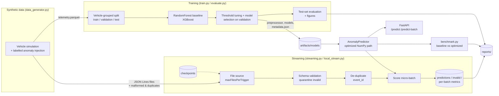

# Real-Time Vehicle Telemetry Anomaly Detection & Edge ML Optimization

[](https://github.com/Charanloyal/Real-Time-Vehicle-Telemetry-Anomaly-Detection-Edge-ML-Optimization/actions/workflows/ci.yml)
[](https://render.com/deploy?repo=https://github.com/Charanloyal/Real-Time-Vehicle-Telemetry-Anomaly-Detection-Edge-ML-Optimization)

End-to-end portfolio project. It generates vehicle telemetry, trains scikit-learn and XGBoost anomaly detectors,
validates and scores event streams with PySpark Structured Streaming (with a pandas fallback engine), serves
predictions over FastAPI, and benchmarks an optimized inference path against a straightforward baseline.

> **Data disclaimer:** every dataset in this repository is **synthetic**, produced by
> [`data_generator.py`](src/vehicle_anomaly/data_generator.py). No real vehicle, fleet or production telemetry
> is used, and none of the metrics below describe real-world performance.

## Contents

- [Architecture](#architecture)
- [Features and status](#features-and-status)
- [Technology stack](#technology-stack)
- [Repository structure](#repository-structure)
- [Installation](#installation)
- [Running the project](#running-the-project)
- [Model training and evaluation](#model-training-and-evaluation)
- [Streaming pipeline](#streaming-pipeline)
- [API and live demo](#api-and-live-demo)
- [Inference optimization and benchmark](#inference-optimization-and-benchmark)
- [Testing and CI](#testing-and-ci)
- [Docker](#docker)
- [Deploying to Render](#deploying-to-render)
- [Configuration](#configuration)
- [Limitations and future work](#limitations-and-future-work)

## Architecture



## Features and status

| Area | Status | Notes |
|---|---|---|
| Synthetic telemetry generator (seeded, configurable volume) | Implemented | 5 anomaly types; streaming files with 6 kinds of malformed events and duplicates |
| RandomForest baseline and XGBoost classifier | Implemented | Vehicle-grouped splits, validation-tuned thresholds, saved artifacts |
| Evaluation: precision, recall, F1, ROC-AUC, PR-AUC, confusion matrix | Implemented | Plus recall per anomaly type and Matplotlib figures |
| Optimized inference path and benchmark | Implemented | Measured numbers below; bit-identical scores to the reference path |
| Streaming: pandas micro-batch engine (default on Windows) | Implemented and verified | File checkpoint, idempotent per-batch sinks, recovery tested |
| Streaming: PySpark Structured Streaming engine | Implemented, **partially verified** | Spark validation and `foreachBatch` logic verified on this machine against the pandas engine (in-memory DataFrame). The Spark file source and checkpoint path needs Linux, Docker, WSL or Windows `winutils` and **has not been executed** here (see [Spark on Windows](#spark-on-windows)) |
| FastAPI service (`/health`, `/model-info`, `/predict`, `/predict-batch`, `/docs`) | Implemented and verified | Model loaded once at startup; `PORT` env var; `/health` returns 503 without a model |
| Browser demo at `/` (single-event scoring, live stream simulation, reports) | Implemented and verified locally | Plain HTML/JS served by FastAPI; no external scripts |
| Structured JSON logging and reports | Implemented | `reports/*.md`, `reports/*.json`, `reports/figures/*.png` |
| Dockerfile (API) and `Dockerfile.spark`, docker-compose | Written; built and smoke-tested by GitHub Actions | Docker is not installed on the development machine |
| Render deployment (`render.yaml` Blueprint, free plan) | Configured | See [Deploying to Render](#deploying-to-render) |
| Kafka source | Not implemented | Planned (see future work) |

## Technology stack

Python 3.10+ (developed on 3.14.7; the Docker image uses 3.11) · pandas · NumPy · scikit-learn · XGBoost ·
PySpark 4.1 (optional) · FastAPI + Uvicorn + Pydantic v2 · Matplotlib · PyArrow · pytest · Docker.

## Repository structure

```
vehicle-telemetry-anomaly-detection/
├── src/vehicle_anomaly/
│   ├── config.py           # typed YAML config + env overrides
│   ├── schema.py           # data contract: fields, units, valid ranges, model features
│   ├── logging_utils.py    # structured JSON / key=value logging
│   ├── data_generator.py   # synthetic telemetry + streaming files
│   ├── preprocessing.py    # feature builder, sklearn pipeline, vehicle-grouped split
│   ├── train.py            # RandomForest + XGBoost training, threshold tuning, artifacts
│   ├── evaluate.py         # test-set metrics, per-type recall, figures, report
│   ├── artifacts.py        # artifact save/load + metadata
│   ├── predict.py          # AnomalyPredictor (optimized inference) + CLI
│   ├── benchmark.py        # latency/throughput benchmark + environment capture
│   ├── validation.py       # event validation rules (pandas / pure Python)
│   ├── stream_common.py    # shared micro-batch sink, metrics, run summary
│   ├── local_stream.py     # pandas micro-batch engine (fallback)
│   ├── streaming.py        # PySpark Structured Streaming engine + orchestrator
│   ├── reporting.py        # Matplotlib figures + Markdown tables
│   ├── api.py              # FastAPI application + demo endpoints
│   └── static/demo.html    # browser demo served at /
├── configs/config.yaml
├── scripts/                # CLI wrappers (generate, train, evaluate, benchmark, stream, API, smoke tests)
├── tests/                  # 78 unit + integration tests
├── data/                   # see data/README.md (generated files are git-ignored)
├── artifacts/models/       # trained artifacts (git-ignored)
├── reports/                # committed evaluation / benchmark / streaming reports + figures
├── .github/workflows/ci.yml  # tests on Linux (Java + PySpark), Docker build + smoke test
├── Dockerfile, Dockerfile.spark, docker-compose.yml, .dockerignore
├── render.yaml             # Render Blueprint (free web service)
├── requirements.txt, requirements-dev.txt, requirements-spark.txt, pyproject.toml
├── Makefile, .env.example, .gitignore, .gitattributes
└── README.md
```

## Installation

### Windows (PowerShell)

```powershell
cd vehicle-telemetry-anomaly-detection
python -m venv .venv
.\.venv\Scripts\Activate.ps1          # if blocked: Set-ExecutionPolicy -Scope CurrentUser RemoteSigned
python -m pip install --upgrade pip
pip install -r requirements-dev.txt   # runtime + pytest/httpx
pip install --no-deps -e .            # installs the vehicle_anomaly package (editable)

# Optional: Spark engine (also needs Java 17+; see "Spark on Windows")
pip install -r requirements-spark.txt
```

### Linux / macOS

```bash
python3 -m venv .venv && source .venv/bin/activate
pip install --upgrade pip
pip install -r requirements-dev.txt && pip install --no-deps -e .
pip install -r requirements-spark.txt   # optional; requires a Java 17+ runtime (e.g. apt install openjdk-17-jre-headless)
```

Equivalent `make` targets exist (`make install data train benchmark api stream test`).

## Running the project

The simplest local demo needs only the core install. Run these from the project root:

```powershell
python scripts/generate_data.py          # 1. synthetic training data + streaming input  (~5 s)
python scripts/train_model.py            # 2. train RF + XGBoost, evaluate on test split (~10 s)
python scripts/evaluate_model.py         # 3. (re-)evaluate saved models -> reports/model_evaluation.md
python scripts/benchmark_inference.py    # 4. latency benchmark -> reports/benchmark_results.md (~5 min)
python scripts/run_streaming.py --reset  # 5. streaming demo -> reports/streaming_summary.md
python scripts/run_api.py                # 6. API + demo on http://localhost:8000 (docs at /docs)
python scripts/api_smoke_test.py         # 7. in a second terminal: exercise every endpoint
python -m pytest                         # 8. test suite
```

Faster benchmark for a quick check: `python scripts/benchmark_inference.py --iterations 300 --batch-iterations 5`.
Score a file from the command line: `python scripts/predict_file.py data/sample/sample_events.json`.

## Model training and evaluation

**Features.** The model reads the seven sensor inputs (`speed`, `engine_rpm`, `engine_temperature`,
`fuel_level`, `battery_voltage`, `brake_pressure`, `acceleration`). It adds three derived features:
`rpm_per_speed`, `abs_acceleration` and `brake_accel_product`. Median imputation is fitted on the training split
only.

**Leakage controls.**
- `event_id`, `vehicle_id`, timestamps, GPS position, `is_anomaly` and `anomaly_type` are never model inputs.
- Train, validation and test splits are grouped by `vehicle_id` with `GroupShuffleSplit` (70/15/15 vehicles).
  No vehicle's events appear in more than one split.
- XGBoost early stopping, the decision threshold (max F1) and the model choice (`average_precision`) all use the
  **validation** split only. The test split is scored once, for reporting.

**Measured results** from the default config (200,000 synthetic events, 15 unseen test vehicles, 30,000 test events,
4.86% anomalies). The full report is in [reports/model_evaluation.md](reports/model_evaluation.md).

| Model | Precision | Recall | F1 | ROC-AUC | PR-AUC |
|---|---|---|---|---|---|
| RandomForest (selected) | 0.867 | 0.971 | 0.916 | 0.999 | 0.985 |
| XGBoost | 0.807 | 0.935 | 0.866 | 0.998 | 0.969 |

Recall is lowest for `battery_voltage` (RF 0.94, XGBoost 0.78) and `overheating` (0.92 / 0.91). This is
expected: per-vehicle baselines make one vehicle's mild fault resemble another vehicle's healthy reading. These
are scores on synthetic data with injected faults. They show that the pipeline works, not how a model would
perform in the field.

## Streaming pipeline

```
data/streaming_input/*.jsonl ──> parse ──> validate ──> quarantine invalid ──> de-duplicate ──> score ──> sinks
                                   │                                                          │
                                   └──────────── checkpoints (data/checkpoints/{spark,local}) ┘
```

- **Validation** (the same rules in [`validation.py`](src/vehicle_anomaly/validation.py) and Spark SQL in
  [`streaming.py`](src/vehicle_anomaly/streaming.py)): malformed JSON, missing or null fields, non-numeric
  values, invalid timestamps, and values outside physical ranges. Invalid events go to
  `data/streaming_output/invalid/` together with their reason.
- **Sinks:** `predictions/batch_NNNNNN.parquet` (or `.csv`), `invalid/batch_NNNNNN.jsonl` and
  `metrics/batch_NNNNNN.json`. Files are written atomically and named by batch id. A batch replayed after a crash
  overwrites its own output instead of duplicating it.
- **Recovery:** the Spark engine uses `checkpointLocation`. The local engine commits the processed-file list to
  `local_engine_state.json` only *after* a batch's outputs are written. Re-running resumes, and new files are
  picked up incrementally (covered by tests).
- **Engine selection:** `--engine auto|spark|local`. `auto` uses Spark when PySpark, Java and (on Windows)
  `HADOOP_HOME\bin\winutils.exe` are available. Otherwise it logs the reason and uses the local engine.
- **Triggers:** `available_now` (default; processes the backlog, then stops) or
  `--trigger processing_time --max-runtime 120` (polls continuously).

```powershell
python scripts/run_streaming.py --reset                     # auto engine, fresh run
python scripts/run_streaming.py                             # resume from checkpoint (only new files)
python scripts/run_streaming.py --engine local --reset
python scripts/run_streaming.py --engine spark --reset      # requires Java (+ winutils on Windows)
```

**Measured local-engine run** (default config, Windows laptop described below). Full report:
[reports/streaming_summary.md](reports/streaming_summary.md).

| Metric | Value |
|---|---|
| Input lines / micro-batches | 100,500 / 10 |
| Invalid events quarantined | 1,000 (matches the 1,000 injected) |
| Duplicates dropped | 500 (matches the 500 injected) |
| Events scored / anomalies flagged | 99,000 / 5,006 |
| Precision / recall vs. synthetic labels | 0.974 / 0.970 |
| Processing time (parse + validate + score + write) | 1.47 s for all batches (~68,600 rows/s) |

### Spark on Windows

On this Windows machine, PySpark 4.1.3 with a portable Temurin JDK 17 starts correctly. The Spark validation
and `foreachBatch` code was verified by `test_spark_validation_and_batch_processing_match_local`. That test
feeds the generated stream into an in-memory DataFrame and checks that invalid reasons, de-duplication, scores
and timestamps match the pandas engine exactly.

The Spark **file source and checkpoint** go through Hadoop's local filesystem. On Windows this fails with
`UnsatisfiedLinkError: NativeIO$Windows.access0` unless `HADOOP_HOME` points to `winutils.exe` and
`hadoop.dll`. Apache does not distribute these binaries; community builds exist but are third-party. They were
deliberately **not** installed on the development machine, so `test_spark_engine_matches_local_engine` is
skipped there. To run the full Spark engine, use one of these:

- Linux, macOS or WSL: `pip install -r requirements-spark.txt`, install Java 17, then
  `python scripts/run_streaming.py --engine spark --reset`.
- Docker: `docker compose --profile spark run --rm spark-streaming`.
- Windows: set `JAVA_HOME`, plus `HADOOP_HOME` with a winutils build you trust for Hadoop 3.x.

## API and live demo

Start the API: `python scripts/run_api.py`. It binds `0.0.0.0` on `$env:PORT`, default 8000. Open
<http://localhost:8000/> for the browser demo or <http://localhost:8000/docs> for interactive API docs.

The **demo page** (`/`) has three parts:
- **Score one event:** presets (normal cruise, overheating, battery fault, harsh braking, stall at speed,
  brake while accelerating) or editable readings, sent to `POST /predict`. Shows the score, the threshold and
  the server and round-trip latency.
- **Live stream simulation:** the server generates fresh synthetic events (`GET /demo/events`) and the
  browser scores each micro-batch with `POST /predict-batch`. Predictions are compared with the generator's
  ground truth, which is returned separately and never sent to the model. Shows running precision/recall, a
  score chart and the latest events. It stops automatically after 120 batches or when the tab is hidden.
- **Reports:** the benchmark table, labelled with the developer machine it was measured on; the streaming run
  executed during the image build; and the evaluation figures.

| Method | Path | Description |
|---|---|---|
| GET | `/` | Browser demo |
| GET | `/health` | 200 `ok` with the model name, or **503** `degraded` with the load error if no model is loaded |
| GET | `/model-info` | Model type, threshold, features, validation/test metrics, library versions |
| POST | `/predict` | Score one event |
| POST | `/predict-batch` | Score `{"events": [...]}` (1 to `api.max_batch_size` = 1,000 events) |
| GET | `/demo/events?n=20&anomaly_rate=0.1&seed=` | 1–200 fresh synthetic events plus separate ground-truth labels |
| GET | `/demo/reports` | Model evaluation, benchmark and streaming summary JSON |
| GET | `/demo/figures/{name}.png` | Report figures (allow-listed names only) |

Payloads are validated by Pydantic. Out-of-range, non-numeric or missing fields return **422** with the
offending field. Calls return **503** if no model is loaded. Every response includes an
`X-Process-Time-Ms` header.

```powershell
$event = @{
  event_id = "demo-1"; vehicle_id = "VEH-0001"; event_timestamp = "2026-01-01T00:10:42Z"
  speed = 35.0; engine_rpm = 2100; engine_temperature = 121.5; fuel_level = 40
  battery_voltage = 11.4; brake_pressure = 0.5; acceleration = 0.3; latitude = 40.1; longitude = -95.2
} | ConvertTo-Json
Invoke-RestMethod -Uri http://localhost:8000/predict -Method Post -ContentType "application/json" -Body $event
```

```bash
curl -s -X POST http://localhost:8000/predict -H "Content-Type: application/json" \
  -d '{"event_id":"demo-1","vehicle_id":"VEH-0001","event_timestamp":"2026-01-01T00:10:42Z","speed":35.0,"engine_rpm":2100,"engine_temperature":121.5,"fuel_level":40,"battery_voltage":11.4,"brake_pressure":0.5,"acceleration":0.3,"latitude":40.1,"longitude":-95.2}'
```

Response from the locally trained model:

```json
{"event_id":"demo-1","vehicle_id":"VEH-0001","is_anomaly":true,"anomaly_score":0.998943,"threshold":0.6963431837224596,"model_name":"random_forest"}
```

`POST /predict-batch` returns `{"model_name", "threshold", "count", "anomaly_count", "predictions": [...]}`.
`python scripts/api_smoke_test.py --url http://localhost:8000` exercises every endpoint using the local test
split. `python scripts/deploy_smoke_test.py --url <base-url>` needs only the standard library and checks a
deployed instance, including the demo page, demo endpoints and figures.

## Inference optimization and benchmark

**Baseline (reference) path**, the straightforward implementation:
`pandas.DataFrame([event])` → fitted sklearn `Pipeline.transform` (column selection, dtype coercion, derived
features, imputation) → `model.predict_proba`.

**Optimized path** ([`predict.py`](src/vehicle_anomaly/predict.py)):

1. Build a float64 NumPy matrix directly from the 7 required fields. There is no DataFrame, no
   unused-column handling and no dtype coercion.
2. Apply the derived-feature formulas (the same function as training) and the fitted imputer medians with NumPy.
3. Load the model and preprocessing objects once and reuse them.
4. Make low-overhead model calls. XGBoost uses `Booster.inplace_predict` with the early-stopping iteration
   range. The scikit-learn forest scores batches under 256 rows single-threaded, avoiding joblib thread-pool
   start-up on every call (the model was trained with `n_jobs=-1`).
5. Batch prediction makes one vectorized call per batch.

**Methodology.** Single Python process, `time.perf_counter_ns`, GC disabled during timed loops, 100 warm-up
calls. 2,000 timed single-event calls per variant, cycling through the 30,000 test-split events. Batches of
1,000 events (20 timed batches; 3 for the slow per-event loop). Before timing, scores are compared on 500 events.
`numpy_features` changes only the feature extraction, which isolates its effect.

**Environment:** Windows 11 (10.0.26200), Intel Core Ultra 5 235 (14 logical CPUs), 63.7 GB RAM, Python
3.14.7, scikit-learn 1.7.2, XGBoost 3.4.1, NumPy 2.5.4, pandas 2.3.3. This was a developer laptop on AC power
with normal background processes; no CPU pinning or isolation was used.

**Measured results** (run 2026-10-27; full tables in [reports/benchmark_results.md](reports/benchmark_results.md)):

| Model | Variant | Mean ms | p50 ms | p95 ms | Predictions/s |
|---|---|---|---|---|---|
| XGBoost | baseline | 2.875 | 2.797 | 3.666 | 348 |
| XGBoost | numpy_features | 0.352 | 0.311 | 0.527 | 2,839 |
| XGBoost | optimized | 0.218 | 0.181 | 0.371 | 4,588 |
| RandomForest | baseline | 35.41 | 36.50 | 43.15 | 28 |
| RandomForest | numpy_features | 30.96 | 32.02 | 37.32 | 32 |
| RandomForest | optimized | 4.355 | 3.958 | 7.795 | 230 |

- **XGBoost single-event latency: −92.4% mean** (2.875 → 0.218 ms). The feature-extraction change alone gives
  −87.7%.
- **RandomForest single-event latency: −87.7% mean** (35.4 → 4.4 ms). Almost all of this comes from avoiding
  thread-pool start-up on 1-row calls. The feature-extraction change alone gave −12.6% in this run and −2.8% in an
  earlier run on the same machine, because the forest's latency is dominated by tree traversal and threading
  noise.
- **Batch of 1,000:** XGBoost optimized batch 730,119 predictions/s, which is 2.57x the vectorized pandas
  baseline and 2,102x a per-event loop. RandomForest: 30,029 predictions/s (1.09x vectorized baseline).
- **Score parity:** max |score difference| ≤ 4.4e-16, and 100% of decisions agree.

The large single-event percentages are measured against a per-event pandas baseline. Against an already
vectorized batch baseline the gains are much smaller (1.09x–2.57x). Expect variation of ±10% or more between
runs on a shared laptop.

## Testing and CI

```powershell
python -m pytest            # whole suite
python -m pytest -m spark   # only the Spark tests (skipped automatically without PySpark/Java)
```

| File | Covers |
|---|---|
| `test_config.py` | YAML loading, path resolution, env overrides, invalid keys and values |
| `test_logging.py` | JSON and text structured log formatting |
| `test_data_generator.py` | Reproducibility, schema, ranges, label consistency, streaming fault injection, demo sampling |
| `test_preprocessing.py` | Derived features, imputation, vehicle-grouped split, every validation rule |
| `test_prediction.py` | Training artifacts, no split leakage, optimized-vs-reference score parity, thread limits, CLI edge cases, benchmark report |
| `test_api.py` | All endpoints, demo page and demo endpoints, validation errors, batch limits, figure allow-list, 503 without a model |
| `test_streaming.py` | Local engine end-to-end, checkpoint recovery and incremental files, CSV sink, Spark parity |

**Latest run on the development machine** (Windows, Python 3.14.7, `JAVA_HOME` set to a JDK 17):
**77 passed, 1 skipped** in 42 s. The skipped test is the Spark file-source test, for the Windows `winutils`
reason explained above. Without Java, the in-memory Spark test is skipped as well.

**GitHub Actions** ([ci.yml](.github/workflows/ci.yml)) runs on every push and pull request:
1. **Tests** on Ubuntu with Python 3.11, Temurin Java 17 and PySpark. This includes the Spark file-source
   streaming test that cannot run on the Windows development machine.
2. **Docker:** builds the image, runs it like Render (`PORT=10000`, 512 MB memory limit, half a CPU, 1
   inference thread) and runs `scripts/deploy_smoke_test.py` against it.

## Docker

The image trains the models at build time from seeded synthetic data and runs the streaming pipeline once,
so it ships its own evaluation and streaming reports and no model binaries are committed. It installs
`xgboost-cpu`: the same `xgboost` package without the CUDA/NCCL dependency of the standard Linux wheel.

```powershell
docker build -t vehicle-telemetry-anomaly-api:latest .
docker run --rm -p 8000:8000 -e PORT=8000 vehicle-telemetry-anomaly-api:latest
# or
docker compose up --build api
# optional Spark streaming demo (Dockerfile.spark: Linux container with Java 17 + PySpark)
docker compose --profile spark run --rm spark-streaming
```

The container runs as a non-root user, binds `0.0.0.0:$PORT` and has a `/health` HEALTHCHECK.

> Docker is not installed on the development machine. The API image is built and smoke-tested by the
> GitHub Actions `docker` job. `Dockerfile.spark` is not built in CI.

## Deploying to Render

[render.yaml](render.yaml) is a [Render Blueprint](https://render.com/docs/blueprint-spec). It defines one
**free** Docker web service: Render builds `./Dockerfile`, injects `PORT`, and only routes traffic to a new
deploy once `GET /health` returns 200. With `autoDeployTrigger: checksPass`, later pushes to `main` are
deployed only after the GitHub Actions checks pass. It sets `VTAD_INFERENCE_THREADS=1` and
`OMP_NUM_THREADS=1` because the free instance has a fraction of one CPU. The file was validated against
Render's published JSON schema.

1. Click **Deploy to Render** at the top of this README, or in the Render dashboard choose
   **New > Blueprint** and select this repository.
2. Confirm the service name, then **Apply**. The first build takes several minutes (dependencies, then
   training and a 100,500-event streaming run inside the build).
3. Open `https://<service-name>.onrender.com/`, then verify the deployment with:

   ```powershell
   python scripts/deploy_smoke_test.py --url https://<service-name>.onrender.com --wait 120
   ```

**Free-plan behaviour:** the service sleeps after about 15 minutes without traffic. The first request after
that takes up to a minute while it wakes up, and the demo page shows a "waking up" message during that time.
Latency on the shared free CPU is higher than the laptop benchmark numbers.

## Configuration

All settings are in [configs/config.yaml](configs/config.yaml): data volume, anomaly, malformed and duplicate
rates, model hyper-parameters, benchmark iterations, streaming engine, trigger and output format, and API batch
limit. Relative paths resolve against the project root. Environment overrides:

| Variable | Effect |
|---|---|
| `VTAD_CONFIG` | Path to an alternative config file |
| `VTAD_MODEL_DIR` | Model artifact directory |
| `LOG_LEVEL` | Logging level (`INFO`, `WARNING`, ...) |
| `VTAD_INFERENCE_THREADS` | Cap model inference threads (`api.inference_threads`; Render uses 1) |
| `PORT` / `HOST` | API bind port and address (default `8000` / `0.0.0.0`) |
| `JAVA_HOME`, `HADOOP_HOME` | Spark engine prerequisites |

See [.env.example](.env.example). No secrets are required.

## Limitations and future work

**Limitations**

- Synthetic data only. Anomalies are injected single-event faults, which are easier to separate than real
  faults. The models have never seen real telemetry.
- Features are per-event (stateless). Drift-type faults that only show over time, such as slowly rising
  temperature, are not modelled.
- De-duplication covers each micro-batch, not across batches.
- Spark scoring runs on the driver inside `foreachBatch`. That suits a single node; a cluster deployment
  should use `mapInPandas` on executors.
- The Spark file-source path has not run on the Windows development machine; it is exercised only by the
  Linux CI job. `Dockerfile.spark` is not built in CI.
- Benchmarks come from one laptop and include normal OS noise. The free Render instance is slower.
- The public demo has no authentication or rate limiting beyond request validation and batch-size limits.

**Future work**

- Optional Kafka source (Docker Compose profile), with the existing local file demo kept as the default.
- Windowed per-vehicle features (rolling statistics) with Spark watermarks, and cross-batch de-duplication with
  `dropDuplicatesWithinWatermark`.
- Executor-side scoring via `mapInPandas`, and ONNX or Treelite export for edge targets.
- Model registry and versioned artifacts (for example MLflow), plus drift monitoring on streaming metrics.
