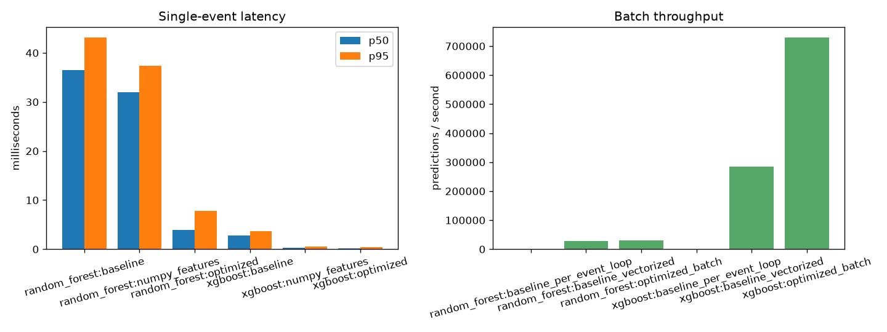

# Inference benchmark results

Measured at 2026-10-27T11:51:29+00:00 on the machine below. Numbers are wall-clock measurements from `time.perf_counter_ns` in a single Python process; other workloads on the machine were not controlled, so expect run-to-run variation.

| Property | Value |
|---|---|
| OS | Windows-11-10.0.26200-SP0 |
| CPU | Intel(R) Core(TM) Ultra 5 235 |
| Logical CPUs | 14 |
| RAM (GB) | 63.70 |
| Python | 3.14.7 |
| scikit-learn | 1.7.2 |
| xgboost | 3.4.1 |
| numpy / pandas | 2.5.4 / 2.3.3 |
| In container | False |

Settings: 2,000 timed single-event calls per variant after 100 warm-up calls; batch size 1,000 with 20 timed batches (3 for the per-event loop). Events come from the held-out test split (30,000 events).

## random_forest (RandomForestClassifier)

Single-event latency:

| Variant | Mean ms | p50 ms | p95 ms | p99 ms | Predictions/s |
|---|---|---|---|---|---|
| baseline | 35.41 | 36.50 | 43.15 | 46.46 | 28.24 |
| numpy_features | 30.96 | 32.02 | 37.32 | 40.43 | 32.30 |
| optimized | 4.3545 | 3.9576 | 7.7948 | 9.6486 | 229.65 |

- Mean latency improvement (baseline -> optimized): **87.7%**
- p50 latency improvement: **89.2%**
- Feature extraction change alone (baseline -> numpy_features): **12.6%** mean latency

Batch scoring (1,000 events per call):

| Variant | Mean ms / batch | Predictions/s | Timed batches |
|---|---|---|---|
| baseline_per_event_loop | 34,113.7 | 29.31 | 3 |
| baseline_vectorized | 36.18 | 27,636.1 | 20 |
| optimized_batch | 33.30 | 30,029.1 | 20 |

- Optimized batch vs per-event baseline loop: **1024.4x** throughput
- Optimized batch vs vectorized baseline: **1.09x** throughput
- Score parity on 500 events: max |diff| = 4.44e-16 (single), 4.44e-16 (batch); decision agreement 100.00%

## xgboost (XGBClassifier)

Single-event latency:

| Variant | Mean ms | p50 ms | p95 ms | p99 ms | Predictions/s |
|---|---|---|---|---|---|
| baseline | 2.8751 | 2.7972 | 3.6661 | 4.1578 | 347.82 |
| numpy_features | 0.3522 | 0.3114 | 0.5273 | 0.8623 | 2,839.2 |
| optimized | 0.2180 | 0.1813 | 0.3711 | 0.5668 | 4,587.9 |

- Mean latency improvement (baseline -> optimized): **92.4%**
- p50 latency improvement: **93.5%**
- Feature extraction change alone (baseline -> numpy_features): **87.7%** mean latency

Batch scoring (1,000 events per call):

| Variant | Mean ms / batch | Predictions/s | Timed batches |
|---|---|---|---|
| baseline_per_event_loop | 2,879.5 | 347.28 | 3 |
| baseline_vectorized | 3.5183 | 284,229.4 | 20 |
| optimized_batch | 1.3696 | 730,118.9 | 20 |

- Optimized batch vs per-event baseline loop: **2102.4x** throughput
- Optimized batch vs vectorized baseline: **2.57x** throughput
- Score parity on 500 events: max |diff| = 0.00e+00 (single), 0.00e+00 (batch); decision agreement 100.00%

