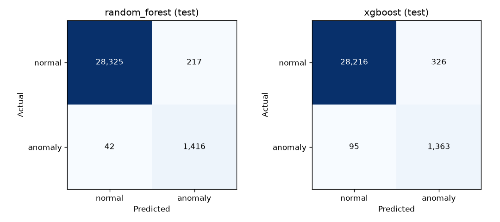
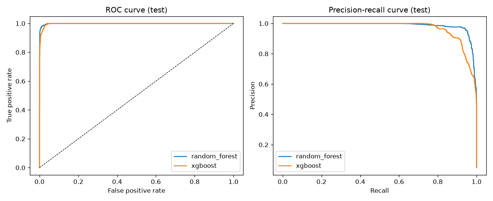
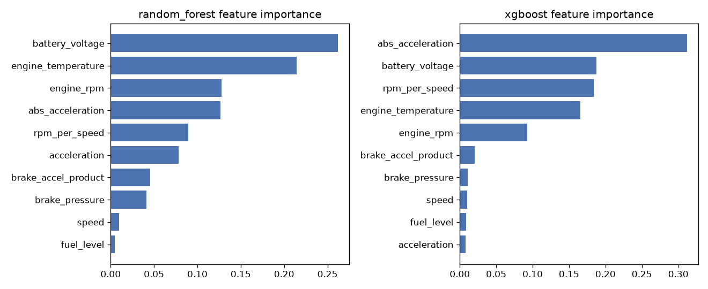

# Model evaluation (test split)

Data: **synthetic** telemetry from `vehicle_anomaly.data_generator`. Splits are grouped by vehicle; thresholds and model selection use the validation split only. The test split is used once for the figures below.

- Train: 140,000 events / 70 vehicles
- Validation: 30,000 events / 15 vehicles
- Test: 30,000 events / 15 vehicles (4.86% anomalies)
- Selection metric (validation): `average_precision`

| Model | Threshold | Precision | Recall | F1 | ROC-AUC | PR-AUC |
|---|---|---|---|---|---|---|
| random_forest (selected) | 0.6963 | 0.8671 | 0.9712 | 0.9162 | 0.9991 | 0.9854 |
| xgboost | 0.9420 | 0.8070 | 0.9348 | 0.8662 | 0.9979 | 0.9687 |

## Recall by anomaly type (false-positive rate for `normal`)

| Type | random_forest | xgboost |
|---|---|---|
| battery_voltage | 0.9418 | 0.7842 |
| harsh_acceleration | 0.9931 | 0.9863 |
| normal | 0.0076 | 0.0114 |
| overheating | 0.9226 | 0.9091 |
| rpm_anomaly | 1.0000 | 0.9965 |
| sensor_combination | 1.0000 | 1.0000 |

## Confusion matrices

- **random_forest**: TN=28,325 FP=217 FN=42 TP=1,416
- **xgboost**: TN=28,216 FP=326 FN=95 TP=1,363

