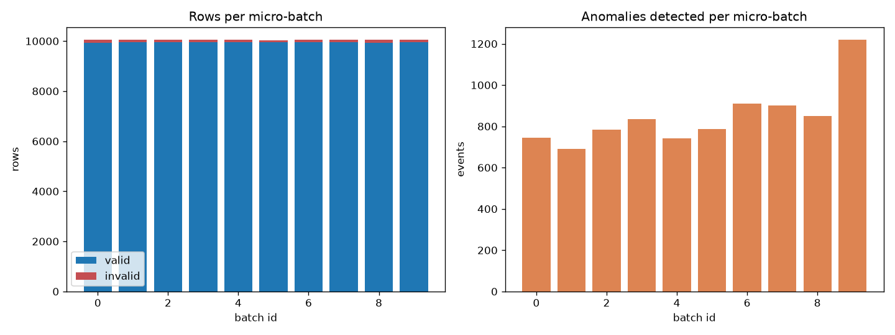

# Streaming run summary

Generated 2026-10-27T14:18:24+00:00. Engine(s): local. Input: synthetic JSON Lines files.

| Metric | Value |
|---|---|
| Micro-batches | 10 |
| Input events | 100,500 |
| Valid events | 99,500 |
| Invalid events (quarantined) | 1,000 |
| Duplicates dropped | 500 |
| Events scored | 99,000 |
| Anomalies detected | 8,467 |
| Batch processing time, all batches (s) | 1.9530 |
| Rows/s inside batch processing | 51,461.9 |
| Batches processed by the last run | 10 |
| Wall-clock time of the last run (s) | 2.0500 |

Totals cover every committed micro-batch in the output directory; a re-run that resumes from the checkpoint only adds new batches.

## Invalid events by category

| Category | Events |
|---|---|
| missing_field | 335 |
| malformed_json | 183 |
| invalid_timestamp | 171 |
| out_of_range | 157 |
| non_numeric | 154 |

## Detection vs. synthetic ground truth

Model: `random_forest_window` (window features). Matched 99,000 scored events to generator labels: precision 0.9180, recall 0.9544 (TP=7,773, FP=694, FN=371).

| Ground-truth type | Events | Flagged as anomaly |
|---|---|---|
| normal | 90,856 | 0.0076 |
| battery_degradation | 1,578 | 0.9937 |
| battery_voltage | 1,015 | 0.9941 |
| gradual_overheating | 1,533 | 0.7867 |
| harsh_acceleration | 1,012 | 0.9980 |
| overheating | 987 | 0.9747 |
| rpm_anomaly | 1,003 | 0.9990 |
| sensor_combination | 1,016 | 1.0000 |

## Per-batch metrics

| Batch | Engine | Input | Valid | Invalid | Dupes | Anomalies | Seconds |
|---|---|---|---|---|---|---|---|
| 0 | local | 10,048 | 9,940 | 108 | 48 | 746 | 0.2020 |
| 1 | local | 10,057 | 9,965 | 92 | 57 | 692 | 0.1581 |
| 2 | local | 10,051 | 9,957 | 94 | 51 | 783 | 0.1567 |
| 3 | local | 10,052 | 9,951 | 101 | 52 | 835 | 0.1651 |
| 4 | local | 10,054 | 9,956 | 98 | 54 | 741 | 0.1796 |
| 5 | local | 10,042 | 9,949 | 93 | 42 | 788 | 0.1755 |
| 6 | local | 10,048 | 9,953 | 95 | 48 | 910 | 0.2199 |
| 7 | local | 10,050 | 9,956 | 94 | 50 | 902 | 0.2388 |
| 8 | local | 10,051 | 9,930 | 121 | 51 | 850 | 0.2287 |
| 9 | local | 10,047 | 9,943 | 104 | 47 | 1,220 | 0.2285 |

